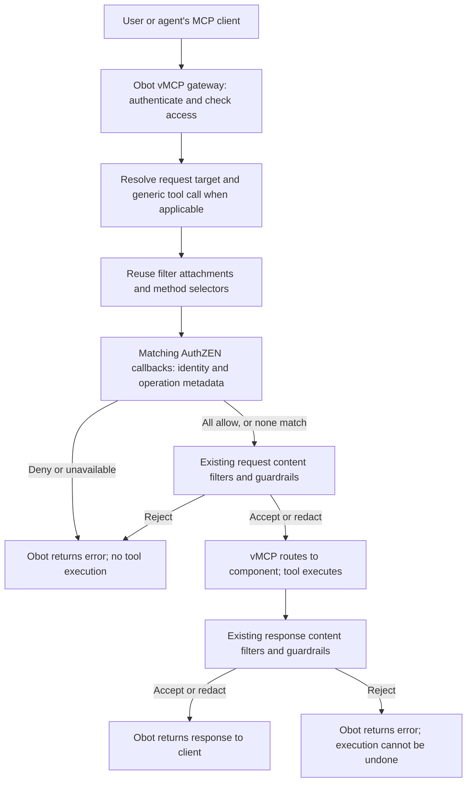

# 2026-10-09: AuthZEN authorization callbacks for MCP filters

- **Authors:** @cloudnautique
- **Created:** 2026-10-09
- **Updated:** 2026-11-03
- **Status:** Draft for architectural review; experimental implementation exists, but this ODP is not established as approved or merged.
- **Implementation reviewed:** Obot branch [`cloudnautique/obot@feature/authzen-filters`](https://github.com/cloudnautique/obot/tree/feature/authzen-filters), commit `ed98c1d19de18187763c942c5e6fff1ef1d081f2`, based on upstream `adcedc997`.

## Summary

Add an optional HTTPS authorization callback to an existing custom **Webhook URL**
filter. Obot authenticates the caller, constructs a bounded AuthZEN evaluation
request, invokes the customer's policy service, and enforces its boolean decision
before running request content filters. Response content filters remain unchanged.

This draft describes the implemented first slice. It does not propose shipping
the broader recovered draft wholesale. MCP authorization tools, standalone
authorization-only filters, payload controls, agent/OBO enrichment, and dedicated
filter-scoped audit queries are deferred. No policy is installed by default.
Rate-limit rules and counters remain in an external service.

This draft reconciles the earlier proposal with the experimental implementation;
it does not supersede an accepted architectural decision.

## Related issues

- Obot customer-demand tracking issue: **TBD**. No issue was available when this
  draft was written. Identify one before submitting this draft for review.
- [MCP ext-auth #14](https://github.com/modelcontextprotocol/ext-auth/issues/14)
  and [#15](https://github.com/modelcontextprotocol/ext-auth/issues/15)
  informed the earlier design discussion. They are
  background references, not dependencies or claims of current conformance.
  Recheck their status and wording when submitting this ODP.

## Related ODPs

- [Virtual MCPs](../2026-09-01-virtual-mcps/README.md) provides context for connection identity, attachment
  inheritance, and tool routing.
- [Local agent Filters](../2026-08-14-local-agent-filters/README.md) provides historical context for the existing filter
  contract. This proposal preserves that contract.

## Problem and motivation

Customers want to decide whether a particular caller can make an MCP request,
and to enforce per-user limits on particular operations. Content-filter payloads
do not carry authenticated identity. Requiring customers to reconstruct identity
from those payloads would create inconsistent and potentially untrusted policy inputs.

Obot should own the identity-to-request mapping and enforcement contract. Customers
should own their policy logic and service deployment. A customer can deploy the
content and authorization endpoints in one service without needing two filter
resources or two deployments.

## Goals

- Evaluate customer authorization policies using identity established by Obot.
- Reuse filter configuration, attachments, selectors, request processing, and audit storage.
- Block execution on a matching authorization denial or evaluation failure.
- Preserve existing content payloads, signing, mutation behavior, and response contracts.
- Support matching client requests across methods, not only `tools/call`.
- Let external services return explicit rate-limit denials without moving quota state into Obot.

## Non-goals

This slice does not implement MCP authorization tools, authorization-only filters,
new policy languages, built-in quota enforcement, policy caching, automatic retries,
configurable payload disclosure, environment enrichment, verified agent identities,
OBO delegation, a new audit store, or a filter-ID audit query/view. It does not
require COAZ, a new client capability, or an adopted MCP authorization extension.

## Context and constraints

External user connections go through a **vMCP**. Direct connections to component
MCP servers are not a supported user connection or login flow. Internal component
connections are implementation details; they are not an independent opportunity
to apply this authorization feature.

Filters already have attachments, method/identifier selectors, credentials,
enablement, and a content pipeline. Upstream also has in-process guardrail filters
and vMCP generic tool-call resolution. Reuse those paths. AuthZEN callbacks in
this slice are configured only on custom HTTP webhook filters, not on guardrail
filters or MCP-backed filters.

The code path can also construct an envelope from an ordinary server configuration.
That internal capability does not make direct component access a supported product
workflow. The vMCP identity limitations below are particularly important for review.

## Proposed design

Unless explicitly marked as deferred or a release requirement, the behavior in
this section is implemented in the reviewed branch.

### Request pipeline and responsibilities



Each attached filter is evaluated at most once per client request in the
processor, even when several selectors match. Matching callbacks run sequentially
before any request content callback. The stage stops on its first denial or error.
Filters retain their existing ordering and attachment/matching semantics.
This is not an exactly-once guarantee across client retries or distributed delivery.

Requests with an ID are eligible. Notifications, server-originated messages, and
responses are outside AuthZEN evaluation. Initialization, discovery, prompts,
resources, and other methods may match; there is no tools-only gate.

For vMCP tool search, the existing resolver supplies the underlying tool name to
authorization and content hooks. Selectors targeting the `call_tool` wrapper also
continue to match. Content mutations are checked before restoring the wrapper;
the existing resolver preserves the validated tool reference and revision.

When authorization is configured on the target, content filters may change
argument values but cannot change the method or mapped operation properties.
This guard also prevents turning an initially unmatched operation into one
covered by an authorization selector. A violation blocks with the authorization
unavailable error. This does not authorize argument-level business semantics:
arguments are not part of the policy input in this slice.

### Configuration and administrator experience

Use **MCP Servers > Filters**, the existing custom filter editor, and Type
**Webhook URL**. Keep the content URL and existing selector/resource picker.
Enable **Authorize requests with AuthZEN**, enter an HTTPS evaluation endpoint,
and optionally supply a separate authorization signing secret.

The additive manifest block is:

```json
{
  "authorization": {
    "enabled": true,
    "url": "https://policy.example.com/access/v1/evaluation",
    "secret": "example-only-configure-out-of-band"
  }
}
```

This is a partial manifest example, not a complete filter creation request.
The existing content URL remains required. `secret` is optional and is removed
from the persisted public manifest and responses after credential extraction.
`signingEnabled` is server-managed; `hasAuthorizationSecret` reports credential
presence without revealing the value.

One filter may point `/authorize` and `/filter` to the same deployed service.
The endpoints share attachments and selectors but have separate contracts and
secrets. There is no `contentEnabled` setting or authorization-tool selector.
There is no new authorization navigation area, payload editor, test-request UI,
or filter-scoped decision tab. The demo under `tools/authzen-demo` is a separate
development aid, not a built-in Obot policy service or production UI.

Updates that omit `authorization` preserve its existing configuration. Explicit
`{"authorization":{"enabled":false}}` disables it. The filter's overall disabled
state and attachments affect both callbacks. Existing filters start without
an authorization callback; there is no default policy and no feature gate added
by this slice.

### Envelope and method mapping

Obot creates the envelope from the authenticated request and resolved server
configuration. Clients do not supply the asserted subject or delegation claims.
The envelope vocabulary is `version: 1`; the operation mapping is
`obot-mcp-requests-v2`.

Example for a supported vMCP connection (IDs are illustrative):

```json
{
  "subject": {"type": "user", "id": "user-1"},
  "action": {"name": "tools/call", "properties": {"tool": "get_customer"}},
  "resource": {"type": "mcp-server", "id": "vmcpi-example"},
  "context": {
    "obot": {
      "version": 1,
      "mapping": "obot-mcp-requests-v2",
      "authority": "https://obot.example.com",
      "evaluation_id": "8199398b-8c30-4a50-9c15-f5c0a18a8322"
    }
  }
}
```

| Field | Implemented source and meaning |
| --- | --- |
| `subject.type`, `subject.id` | `user` and the authenticated Obot user's UID. |
| `action.name` | Full MCP method. |
| `action.properties` | Selected operation identifiers, as below; omitted for other methods. |
| `resource.type` | `mcp-server`, including the experimental vMCP mapping. |
| `resource.id` | `ServerConfig.MCPServerName`: selected `vmcpi...` connection on the vMCP path. Ordinary internal server configurations use their deployed server ID, not a per-user MCPServerInstance ID. |
| `context.obot.authority` | Obot's configured server URL. |
| `context.obot.evaluation_id` | Fresh UUID for each filter evaluation, also recorded in audit metadata. |
| `context.obot.catalog_id`, `catalog_entry_id` | Optional values from server configuration; omitted when unavailable. Current vMCP configuration does not supply them. |

| MCP method | `action.properties` |
| --- | --- |
| `tools/call` | `{"tool":"echo"}` |
| `prompts/get` | `{"prompt":"summarize"}` |
| `resources/read`, `resources/subscribe`, `resources/unsubscribe` | `{"uri":"crm://customers/123"}` |
| `completion/complete`, prompt reference | `{"ref":{"type":"ref/prompt","name":"summarize"},"argument":"style"}` |
| `completion/complete`, resource reference | `{"ref":{"type":"ref/resource","uri":"crm://customers/{id}"},"argument":"id"}` |
| Other methods, including list/discovery | No properties; method-only mapping. |

Completion reference fields are policy input and mutation-guard input; the
existing identifier selector does not gain completion-specific matching. Use a
method selector for completion. Invalid required selectors prevent evaluation
and fail closed. This extractor is not a full MCP request schema validator.

**vMCP limitation:** attachments and audit scope use the parent `vmcp...` ID,
while the envelope uses its `vmcpi...` connection ID. Parent and component IDs
are not included. Resolved generic tool names do not establish component identity
or supply component catalog associations. A policy cannot directly match a parent
vMCP ID or component catalog entry from this payload. Resolve this mapping decision
before promising stable parent-level policies or production rollout.

There are no groups, email addresses, source IPs, User-Agent, arbitrary headers,
tool arguments, completion values, or response bodies in the envelope. Method
and identifier are not duplicated in context. Mapping changes require explicit
versioning; the v1-to-v2 change was an unshipped experimental revision.

### Identity, sandboxes, and OBO

The current authentication path supplies users. An agent or sandbox using a
user's credential is represented as that user. Upstream removed hosted-agent
authentication; this slice does not restore it or assert a distinct agent subject.
Ownership does not prove delegation. Client-supplied agent IDs or OBO headers
must not be treated as authoritative identity.

Future agent/OBO support needs a separate decision on credential issuance,
verified acting-agent and delegated-user identity, audience, scope, expiry, and
revocation. Environmental enrichment is also deferred: forwarded source IP would
require installation-owned proxy trust and validated extraction, while User-Agent
would remain caller-reported. Neither is added by this implementation.

### Callback transport, signing, and failure behavior

Obot POSTs JSON with `Content-Type: application/json` and `Accept: application/json`.
It reuses the gateway's restricted outbound HTTP transport and connection pool.
HTTPS is required; URL user information and fragments are rejected. Redirects
are not followed. Client authorization headers and arbitrary MCP headers are
not forwarded to the policy service.

When configured, the authorization secret signs the raw serialized body using:

```text
X-Obot-Signature-256: sha256=<hex HMAC-SHA256 of request body>
```

This is the existing content-webhook signing convention, using a separate secret.
Without a configured secret, the request is unsigned HTTPS. Bearer tokens are not
supported. Receivers must decide whether their deployment permits unsigned calls.

Secrets use encrypted credential storage and are excluded from content runtime
configuration and reveal responses. A signing marker survives independently of
the credential: a missing configured secret blocks instead of silently sending
unsigned requests. Blank edits retain the secret; changing a signed endpoint
requires a newly supplied secret. Credential-to-endpoint binding prevents use of
a replacement secret at an old destination during partial updates.

Each callback has a five-second deadline within a fifteen-second authorization
stage deadline. Responses are limited to 64 KiB. No automatic retries, decision
cache, timestamp-signing extension, or replay-prevention guarantee is provided.
Evaluation IDs can assist receiver deduplication, but client retries create new
evaluations and are not automatically deduplicated.

| Policy service response | Gateway behavior |
| --- | --- |
| HTTP 200, `{"decision":true}` | Continue to the next evaluation, then content filtering. |
| HTTP 200, `{"decision":false}` | HTTP 403; no upstream execution. |
| HTTP 200, false plus the recognized rate-limit context | HTTP 429; no upstream execution. |
| Non-200, timeout, missing decision, invalid JSON, oversized body, or missing configured credential | HTTP 503; no upstream execution. |

Gateway-generated authorization errors use JSON-RPC code `-32001`, retain the
request ID, and do not expose arbitrary policy-service messages or internal hook
prefixes. Existing content-filter HTTP 200/JSON-RPC error behavior remains intact.
Authentication and access checks still precede this feature; authorization callbacks
do not replace them. Parser/protocol rejection can also occur before evaluation
and does not imply that a policy callback was invoked.

### External rate limiting

The receiver returns HTTP 200 with an explicit denial and this Obot extension:

```json
{
  "decision": false,
  "context": {"obot": {"reason": "rate_limited", "retry_after_seconds": 30}}
}
```

Obot returns HTTP 429, `Cache-Control: no-store`, and, when supplied, `Retry-After`.
The client receives a clear retry message and JSON-RPC data containing the reason
and retry interval. The optional interval must be an integer from 1 through 86400;
an invalid interval on a rate-limit denial produces 503. Unknown denial reasons
remain 403. A receiver's HTTP 429 is a callback failure, not a quota decision.

A customer can key counters by subject, resource, method, and tool. With the
current vMCP mapping, resource-specific quotas are connection-specific, not
parent-vMCP quotas. Quotas count admissions: a later content rejection or upstream
failure does not refund them. No reservation/settlement contract is implemented.
A shim to another rate-limit service is possible customer-side work, not part of
this feature. Native gateway rate limiting remains a separate product decision.

### Audit integration

Authorization evaluations extend existing webhook statuses on the protected
request's MCP audit event: type `authorization`, filter ID, evaluation ID,
mapping version, `allow`/`deny`/`error`, and duration. Pre-upstream denials and
errors use the existing blocked-request audit path. An allow is not proof of
successful tool execution.

No new decision store, retention policy, or default raw-envelope persistence is
introduced. HTTP 429 is classified as denied in MCP audit presentation and query
filters, including upstream-generated 429s. Existing rows are classified on read;
no data migration is needed. The HTTP status and authorization detail distinguish
a policy denial from an upstream limit.

The existing filter audit tab's backing-server scope is not a query for policy
evaluations on protected requests. This slice exposes those evaluations in the
protected request's existing audit logs. A filter-ID query and filtered view are
deferred and require authorization-aware query/index design.

### Reused implementation paths

| Existing path in Obot | Change |
| --- | --- |
| `apiclient/types/mcpwebhookvalidation.go` and `pkg/api/handlers/mcpwebhookvalidation.go` | Optional authorization block, validation, old-client preservation, and credential lifecycle. |
| `pkg/mcp/webhookhelper.go`, `backend.go`, `hooks.go` | Reuse attachment discovery, selector compilation, deduplication, and hook mappings. Required authorization survives unavailable content runtime/runner. |
| `pkg/api/handlers/mcpgateway/handler.go`, `proxy_hooks.go`, `generic_tool_call.go` | Same request processor, vMCP resolver, response writer, and content stages; authorize first and guard later action changes. |
| `pkg/api/handlers/mcpgateway/proxy_authorization.go` | Small typed envelope/HTTP-decision adapter; no second gateway route or selector engine. |
| `pkg/api/handlers/mcpgateway/proxy_audit.go` and existing MCP audit types/presenter/query | Evaluation metadata and 429-denial classification in the existing pipeline. |
| `pkg/safehttp/client.go` | Preserve idle-connection cleanup through the restricted transport wrapper. |
| `FilterForm.svelte` and existing service types/localized messages | Optional endpoint and secret fields within the existing Webhook URL flow. |

The content contract and AuthZEN decision contract remain separately typed.
The slice does not refactor the MCP tool runner into a generic authorization
framework. In-process guardrails continue to run in the existing content stage.

## Alternatives considered

### Leave identity-aware policies to content filters

Preserves today's implementation but makes customers reconstruct identity that
the content contract does not establish. It does not solve the requested need.

### Add identity to every content-filter payload

Expands disclosure and changes an established contract. The optional callback
provides a distinct identity-aware policy boundary without that migration.

### Create a separate authorization resource and UI

Duplicates attachments, selectors, credentials, and lifecycle controls. One filter
with two endpoints permits one customer deployment while retaining distinct contracts.

### Deliver MCP tools, payload controls, and OBO together

Useful future capabilities, but they add new transport, disclosure, and identity
decisions. The minimal HTTP slice establishes a smaller reviewable contract first.

### Require COAZ or build rate limiting directly into this feature

Would couple the plugin point to an evolving mapping or a particular policy type.
The implemented envelope is explicitly Obot-versioned; external quotas are separate.
Native rate limiting may be valuable, but need not block the authorization hook.

## Trade-offs

The implementation is small relative to a new policy subsystem, but external
policy calls add latency and availability dependencies. Optional signing eases
integration while leaving unsigned endpoint admission to deployment controls.
Metadata-only policy input limits disclosure but cannot enforce argument-dependent
rules. Reusing selectors preserves compatibility but also preserves their coverage
limits. The current connection-level vMCP identity is a significant product limitation.

## Risks and open questions

| Threat or gap | Current boundary | Required review or follow-up |
| --- | --- | --- |
| Sensitive values leave before content redaction | Arguments and response content are omitted. Resource URIs and selector names are still sent and may themselves contain sensitive values. | Review receiver trust and identifier disclosure before release; do not claim all PII stays inside the organization. |
| External content filters receive unredacted data | Authorization runs first, but does not redact. Existing content-chain ordering controls what each subsequent filter sees. | Review guardrail/redaction ordering separately; an allow is not a privacy guarantee. |
| Forged identity or OBO | Subject comes from authenticated UID; no client delegation claims included. | Design verified agent/OBO issuance before exposing those fields. |
| Endpoint abuse or secret loss | Restricted HTTPS transport, no redirects, endpoint-bound secret, fail closed when configured secret is missing. | Confirm operator permissions and outbound policy in the deployment. |
| Replayed signed policy requests | Body HMAC, evaluation ID, no timestamp/freshness contract. | Receiver-side controls; define any freshness extension separately. |
| Post-authorization retargeting | Full mapped action guard, plus generic-call reference preservation. | Maintain tests as mappings and routing evolve; argument-level policy is out of scope. |
| Parent-vMCP policy cannot match envelope ID | Connection ID only; resolved tool name does not identify component. | Decide parent/instance/component mapping and versioning before production commitments. |
| Policy outage or quota consumed before later rejection | Fail closed; bounded sequential calls; no retries or refunds. | Accept operational semantics and measure latency under expected load. |
| Downgrade silently removes authorization | No automatic incompatible-binary startup rejection is implemented. | Require an explicit rollback procedure before release. |
| Older design records imply broader shipped capability | This draft distinguishes current behavior from deferred work. | Reconcile the companion Proposed ADR before implementation PR approval; its broader decisions and “uncommitted” status are stale. |

Notifications, server-originated messages, and client retries are not additional
policy coverage in this slice. Define their semantics before expanding scope.
No feature approval is implied by the existence of code or passing tests.

## Rollout and migration

1. Review this draft, assign an Obot issue, resolve the vMCP mapping
   and rollout decisions, and obtain architectural approval.
2. Reconcile the Proposed ADR and implementation/docs with the accepted scope.
   Material departures should return through an ODP update.
3. Existing filters require no migration. Operators opt in by configuring and
   enabling the additional callback on a Webhook URL filter, retaining its selectors.
4. Validate with a customer-controlled receiver, including deny, unavailable,
   unsigned/signed, and rate-limit cases. Use synthetic data for diagnostics.
5. Roll back through an explicit operator decision to disable authorization or
   stay on a compatible binary. Older binaries may ignore the new fields; do not
   claim an automatic fail-closed downgrade mechanism.

There is no new table or audit-row migration in this slice. Experimental v1 policy
receivers must be updated for the v2 mapping. Publishing/merging the feature and
publishing this ODP remain separate actions; neither is performed by this draft.

## Testing and validation

Existing tests cover decisions and deadlines, method/property mapping, missing
identity and malformed selectors, signing and endpoint binding, unsigned callbacks,
old-client preservation, content retargeting, completion mutations, audit denials,
429 retry behavior, transport reuse/shutdown, and resolved generic tools without
a content runner. Case-collision tests verify that ambiguous protocol input cannot
reach the upstream tool unchecked. Browser tests cover optional authorization
configuration in the existing editor.

Source evidence is in `proxy_authorization_test.go`, `proxy_hooks_json_test.go`,
`mcpwebhookvalidation_authorization_test.go`, `webhookhelper_authorization_test.go`,
audit presenter/client tests, and `FilterForm.authorization.svelte.spec.ts`.

After the latest rebase, tests passed for `pkg/api/handlers/mcpgateway`,
`pkg/api/handlers`, `pkg/mcp`, and `pkg/gateway/client`. Earlier full Go/lint,
UI type checks, six browser tests, and docs-build results are historical evidence,
not a claim those entire suites were rerun for this draft.

Before release, validate a supported external vMCP connection end to end with a
real receiver, combined authorization/content/guardrail ordering, signed-secret
rotation and outage behavior, audit visibility under existing roles, and concurrent
load/latency. No performance benchmark or exactly-once quota guarantee is asserted.

## References

- Obot ADR (Proposed; reconciliation needed):
  [`adr/2026-10-11-authzen-authorization-filters.md`](https://github.com/cloudnautique/obot/blob/feature/authzen-filters/adr/2026-10-11-authzen-authorization-filters.md).
- Implemented contract:
  [`docs/docs/functionality/filters.md`](https://github.com/cloudnautique/obot/blob/feature/authzen-filters/docs/docs/functionality/filters.md),
  AuthZEN authorization and request-pipeline sections.
- Receiver/demo:
  [`tools/authzen-demo/README.md`](https://github.com/cloudnautique/obot/blob/feature/authzen-filters/tools/authzen-demo/README.md).
- Related ODPs: [Virtual MCPs](../2026-09-01-virtual-mcps/README.md) and
  [Local agent Filters](../2026-08-14-local-agent-filters/README.md).
- Historical standards discussion: [MCP ext-auth #14](https://github.com/modelcontextprotocol/ext-auth/issues/14)
  and [#15](https://github.com/modelcontextprotocol/ext-auth/issues/15). Their
  current status is not revalidated by this implementation reconciliation.
